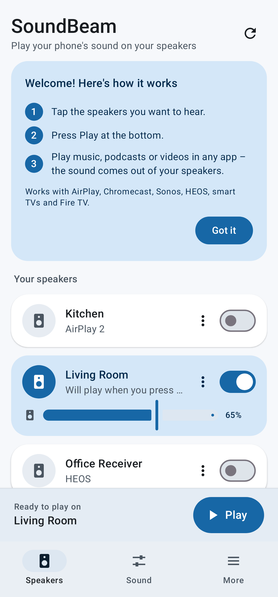
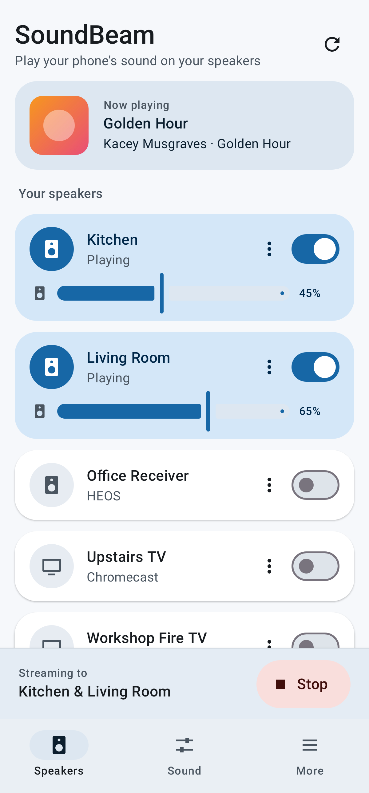
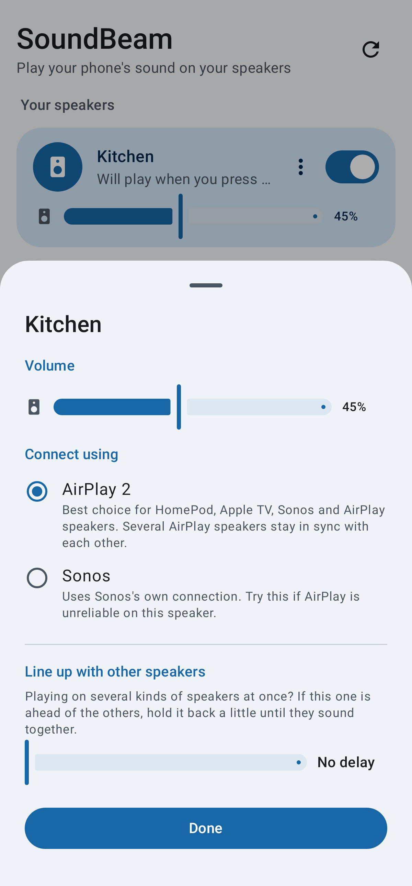
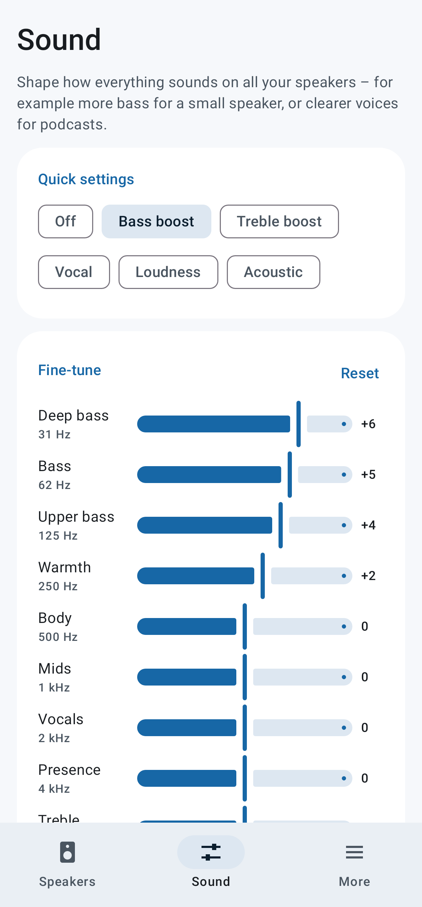
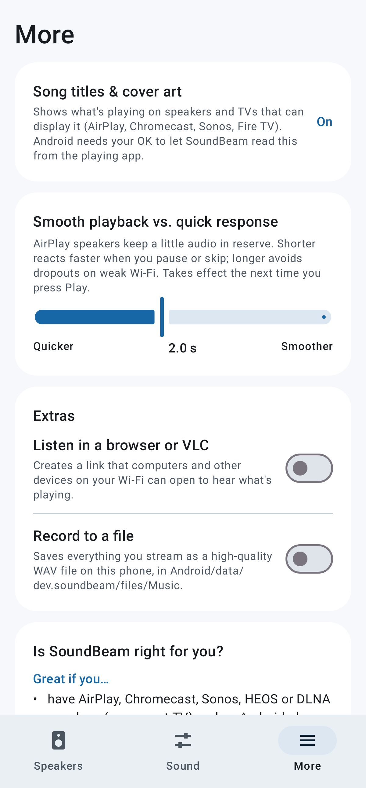
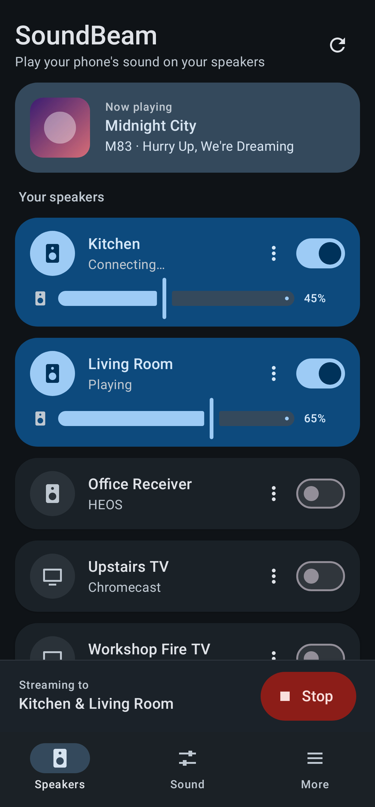

# SoundBeam

Free, open-source Android app that streams **whatever your phone is playing** (Spotify, YouTube Music, a browser, a game…) to speakers and receivers on your Wi-Fi. No account, no ads, no subscription, no root.

> **Status: alpha (v0.3).** Everything compiles and the protocol primitives are verified by unit tests (SRP-6a against pysrp, ALAC decoded bit-identically by ffmpeg, bplist/TLV8 round-trips), but most back-ends have **not yet been tried on real speakers**. Bug reports with logs are very welcome.

## ⬇️ Download

**[Download the latest version →](https://github.com/ganpatig/SoundBeam/releases/latest)**

On that page, under **Assets**, tap:

* **`SoundBeam-x.y.z.apk`** – the phone app (Android 10 or newer). This is the one most people want.
* **`SoundBeam-Receiver-x.y.z.apk`** – optional, install on a **Fire TV / Android TV** to use it as a speaker.

Open the downloaded file on your phone to install it (Android will ask you to allow installs from your browser or file manager the first time).

## Screenshots

| Pick your speakers | Playing in two rooms | Speaker settings |
|---|---|---|
|  |  |  |
| **Sound (equalizer)** | **Extras & help** | **Dark mode** |
|  |  |  |

## Is SoundBeam for you?

**Yes, if you** have AirPlay, Chromecast, Sonos, HEOS or DLNA speakers (or a smart TV / Fire TV) and an Android phone, and want to play sound from *any* app on them – including apps that can't cast by themselves – in one room or several at once. Free, no account, no ads.

**Probably not, if you** only use Bluetooth speakers (Android already does that), need perfect lip-sync for video (network speakers add a short delay), or only use one app that already casts to your speaker (like Spotify Connect).

## What it does

| Feature | Status |
|---|---|
| System-audio capture of other apps (Android 10+) | ✅ |
| **AirPlay 2** (HomePod incl. stereo pairs, AirPlay 2 speakers, Roku, Sonos AP2): transient pairing, PIN pairing for Apple TV, encrypted control + audio | ✅ written, unit-tested, not yet tried on hardware |
| **AirPlay 1 / RAOP** (AirPort Express, older receivers), lossless ALAC | ✅ written, ALAC verified with ffmpeg |
| AirPlay multiroom sync (shared RTP/NTP timeline) | ✅ |
| **Chromecast / Google Cast** (Cast v2, Default Media Receiver, AAC live stream) | ✅ written, not yet tried on hardware |
| **Sonos** (UPnP radio stream + ICY titles) | ✅ written, not yet tried on hardware |
| **HEOS** (Denon/Marantz, HEOS CLI `play_stream`) | ✅ written, not yet tried on hardware |
| **DLNA / UPnP** renderers (WAV) | ✅ |
| **AriaCast** (Music Assistant AriaCast Receiver, AriaCast servers) | ✅ written per the published spec |
| **Fire TV / Android TV** via the bundled **SoundBeam Receiver** app (AriaCast receiver, TV launcher, starts on boot) | ✅ written, not yet tried on hardware |
| Add/remove receivers while playing, per-receiver volume/mute and sync delay, AirPlay latency setting | ✅ |
| Cover art & metadata (notification access): AirPlay DMAP/artwork/progress, Cast/DLNA at start, Sonos/VLC via ICY, AriaCast live | ✅ |
| HTTP stream (`/stream.wav`, `/stream.aac`), save to WAV, 10-band EQ | ✅ |

Not every app allows its audio to be captured: apps that opt out of Android's playback capture (or play DRM-protected audio) come through silent. That is an Android restriction and applies to any app using this API.

## How it works

```
 other apps ──► AudioPlaybackCapture ──► 10-band EQ ──┬─► HttpStreamServer ──► DLNA renderers (via SetAVTransportURI + Play)
                (CaptureService)                       │                  └─► VLC / any HTTP client
                                                       └─► WavFileSink
```

* `CaptureService`: foreground service, owns the `MediaProjection` + `AudioRecord`, 44.1 kHz stereo 16-bit.
* `audio/Equalizer`: RBJ peaking biquads (31 Hz – 16 kHz), software, applies to every output.
* `net/Dlna.kt`: SSDP multicast discovery, device-description parsing, minimal UPnP SOAP client.
* `net/HttpStreamServer`: endless-WAV HTTP server with a bounded per-client queue (slow clients drop audio rather than stalling the capture).

DLNA renderers buffer several seconds, so expect a few seconds of latency. Mixed receivers will not be sample-synchronised.

## Build

Requires JDK 17 and the Android SDK (API 35). Two APKs are built: `app` (the sender, Android 10+) and `receiver` (SoundBeam Receiver for Fire TV / Android TV, Android 5.1+).

```bash
./gradlew assembleDebug testDebugUnitTest
```

APKs land in `app/build/outputs/apk/debug/` and `receiver/build/outputs/apk/debug/`. GitHub Actions builds it on every push (see `.github/workflows/build.yml`).

## Using it

1. Open SoundBeam – it finds the speakers on your Wi-Fi automatically.
2. Tap the speakers you want (each speaker shows up once, even if it supports several connection types).
3. Press **Play** and accept Android's prompt (Android calls it screen recording; SoundBeam only uses the sound).
4. Play music, podcasts or videos in any app.

Each speaker card has its own volume slider. Tap **⋮** on a speaker to change how it connects or to line it up with other speakers. The **Sound** tab has an equalizer; **More** has song-title display, latency, a browser/VLC link, recording and help.

## Clean-room statement

SoundBeam is an independent implementation written from public documentation: the UPnP/DLNA specs, the HEOS CLI spec, the AriaCast protocol spec, the Google Cast v2 wire format, the Android `AudioPlaybackCapture` docs, protocol behaviour documented by open-source projects (owntone, shairport-sync, airplay2-receiver - read for protocol facts only, no code copied) and the feature list on the AirMusic website. It contains no code, assets, or text from AirMusic or any decompiled app, and is not affiliated with it. "AirPlay", "Sonos", "Chromecast", "DLNA" etc. are trademarks of their owners and are used only to describe compatibility.

## Contributing

Protocol back-ends are small, self-contained "sinks"/controllers, which makes new ones a good first contribution (AirPlay RAOP, Cast v2, Sonos UPnP extensions, AriaCast). Open an issue first so work isn't duplicated.

## License

MIT, see [LICENSE](LICENSE).
